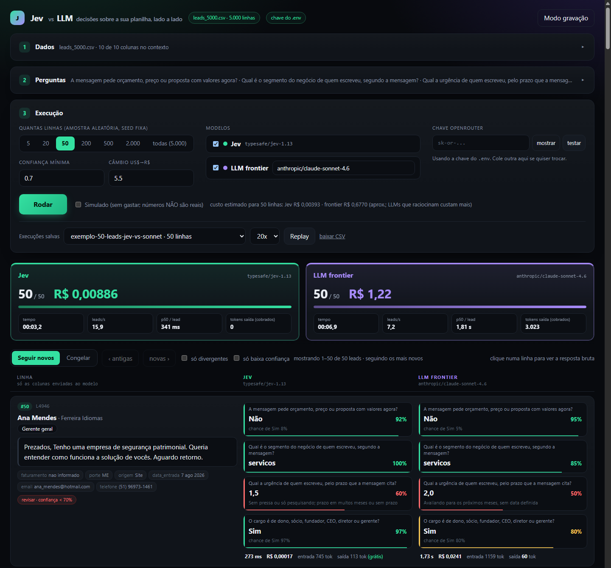

# Jev vs LLM: teste o Jev na sua própria planilha

App local que pega uma planilha (CSV ou Excel), manda cada linha para o **Jev** (`typesafe/jev-1.13`) e para um LLM de sua escolha, e mostra lado a lado o que cada um respondeu, quanto demorou e quanto custou.

Você sobe os seus dados, escolhe quais colunas o modelo enxerga, escreve as perguntas e roda. Tudo pelo navegador.

Este repositório acompanha o reels sobre o Jev no Instagram [@lucasmafamg](https://www.instagram.com/lucasmafamg). Vem com a planilha que usei no vídeo: 5.000 leads de CRM **fictícios** (gerados por código, com seed fixa), com gabarito para medir acerto.



## A premissa

LLM responde escrevendo, um token por vez, e cobra por cada token que escreve. Para uma decisão pequena e repetida (esse lead está pedindo preço? qual o segmento? qual a urgência?) você paga por texto que ninguém vai ler.

O Jev só decide. Ele recebe um contexto (`state`) e perguntas de três tipos, e devolve número:

| Tipo | Na página | O que volta |
|---|---|---|
| `noul` | Sim/Não | probabilidade de ser "sim", de 0 a 1 |
| `choice` | Escolha | a opção escolhida, a confiança e a distribuição entre todas as opções |
| `score` | Nota | uma nota contínua entre os níveis que você descreveu |

Output não é cobrado (US$ 0,042 por milhão de tokens de entrada) e todas as perguntas de uma linha vão numa requisição só.

A demo existe para você ver isso com os seus dados antes de acreditar em qualquer número, inclusive nos meus.

## Resultado com a planilha de exemplo

Medido em 29 e 30/09/2026, mesmas 4 perguntas, mesmas colunas:

| | Jev 1.13 | Claude Sonnet 4.6 |
|---|---|---|
| Custo, 50 leads | US$ 0,0016 | US$ 0,22 |
| Latência p50 por lead | 341 ms | 1,81 s |
| Acurácia média contra o gabarito | 91,5% | 94,0% |
| Custo, 5.000 leads | US$ 0,16 | (não rodei) |

Onde o Jev mais errou foi na urgência (80,5% em 5.000 leads), que depende de ler prazo e data. A documentação do Jev avisa que esse é um ponto fraco dele.

Os dois runs estão em `runs/` e dá para reassistir sem chave nenhuma (veja o passo 6).

## Passo a passo

### 1. Instale

Precisa de Python 3.11+.

```bash
git clone https://github.com/XiangBr/jev-demo.git
cd jev-demo
python -m venv .venv
# Windows: .venv\Scripts\activate    |    Mac/Linux: source .venv/bin/activate
pip install -r requirements.txt
```

### 2. Pegue uma chave do OpenRouter

Crie em [openrouter.ai/keys](https://openrouter.ai/keys) e coloque alguns dólares de crédito. US$ 2 sobra para testar bastante: 5.000 linhas no Jev saem por volta de US$ 0,16.

Você tem duas opções para usar a chave:

- **Colar na página** (mais simples). Ela fica só na aba do navegador e vai para o servidor local a cada execução. Não é gravada em disco nem nos arquivos de `runs/`.
- **Deixar no `.env`**, se for usar sempre: `cp .env.example .env` e preencha `OPENROUTER_API_KEY`.

Sem chave, dá para usar o modo **Simulado**, que inventa respostas para você conhecer a interface sem gastar.

### 3. Rode

```bash
python -m uvicorn app.main:app --port 8000
```

Abra http://localhost:8000.

### 4. Dados

- Sem fazer nada, a página usa a planilha de exemplo (`data/leads_5000.csv`).
- Para usar a sua, arraste um `.csv` ou `.xlsx` na área **Subir CSV ou Excel**. A primeira linha precisa ser o cabeçalho; no Excel, vale a primeira aba. CSV com vírgula ou ponto e vírgula, UTF-8 ou o padrão do Excel no Windows: os dois funcionam.
- Se a planilha não tiver uma coluna `id` única, o app cria uma.
- Marque só as **colunas que as perguntas precisam**. Coluna sobrando custa token e, segundo a documentação do Jev, derruba a acurácia. Nome, e-mail e telefone quase nunca ajudam a decidir.

A planilha que você sobe fica só na memória do servidor local. Se reiniciar o servidor, suba de novo.

### 5. Perguntas

Para cada pergunta, escolha o tipo e escreva:

- **Sim/Não:** "A mensagem pede orçamento ou preço agora?"
- **Escolha:** liste as opções e descreva cada uma ("varejo: loja, e-commerce, mercado...").
- **Nota:** descreva os níveis do menor para o maior, com um exemplo concreto em cada.

O botão **Carregar perguntas do exemplo** traz as 4 do vídeo. Se estiver com a sua planilha, a página avisa para reescrever.

### 6. Execute

1. Escolha quantas linhas (comece com 20 ou 50) e quais modelos. O campo do LLM aceita qualquer modelo do [OpenRouter](https://openrouter.ai/models).
2. Confira o custo estimado ao lado do botão **Rodar**.
3. Rode. Cada linha mostra a resposta de cada modelo, a confiança, o tempo e o custo. Linha amarela é onde os modelos divergem; o selo vermelho marca confiança abaixo do limite.
4. No fim aparecem tempo, custo, acurácia (ou concordância com o LLM, se a planilha não tiver gabarito) e o **pipeline híbrido**: o Jev decide tudo e o LLM revisa só o que ficou com baixa confiança.
5. **Baixar CSV** traz sua planilha original com as respostas de cada modelo em colunas novas.

Para reassistir uma execução sem gastar: escolha em **Execuções salvas** e clique em **Replay**, ou abra `http://localhost:8000/?replay=exemplo-50-leads-jev-vs-sonnet&speed=20`. Com `&rec=1` a página fica no modo gravação de tela.

## Como escrever pergunta que o Jev acerta

- **Uma ideia por pergunta.** Duas perguntas simples rodam juntas no mesmo tempo de uma.
- **Seja literal.** "A mensagem pede orçamento?" funciona melhor que "o lead quer comprar?". O Jev responde a pergunta que você escreveu, não a que você quis dizer.
- **Número, data e conta ficam no código.** Faturamento acima de X, prazo antes de Y, contar itens: resolva com `if` antes ou depois do Jev (veja `app/rules.py`).
- **Descreva as opções e os níveis.** Caso de fronteira explícito vale mais que pergunta longa.
- **Teste em lote pequeno.** A documentação indica melhor desempenho em inglês. Em português funcionou bem nos meus testes, mas confira com as suas perguntas.

## Limites (para não se frustrar)

- Fraco com número, data, contagem e conteúdo adversarial (texto tentando enganar o modelo).
- Não explica a decisão. Você recebe resposta e confiança, sem justificativa.
- Não gera texto. Para resumir, escrever ou extrair um valor do texto, use um LLM.
- Limite de taxa por volta de 1.200 requisições por minuto: 5.000 linhas levam uns 4 a 5 minutos no total, mesmo com cada resposta saindo em ~300 ms.

## Como o app mede

- Mesmas linhas, mesmas perguntas e mesma amostra (seed 42) para todos os modelos.
- Custo vem do `usage.cost` que o OpenRouter devolve. Para o Jev, se o campo faltar, o app calcula pelos tokens de entrada.
- O Jev reporta tokens de saída, mas não cobra por eles. O placar mostra só os cobrados.
- Acurácia só existe para a planilha de exemplo com as perguntas do exemplo (é onde há gabarito). Nos outros casos, a página mostra a concordância com o LLM, que é referência e não verdade.
- A estimativa antes de rodar é aproximada (calibrada com as execuções acima). LLM que raciocina antes de responder custa mais do que ela mostra.

## Estrutura

```
app/main.py            API (FastAPI): planilhas, estimativa, execuções, export
app/datasets.py        leitura de CSV/Excel
app/questions.py       perguntas: validação, formato do Jev, prompt e schema do LLM
app/clients/           cliente do Jev, do LLM (OpenRouter) e o simulado
app/runner.py          roda os modelos em paralelo e emite eventos
app/scoring.py         acurácia, concordância, pipeline híbrido
app/rules.py           regra de código para faturamento (fora do modelo)
app/static/index.html  a interface inteira (HTML + JS, sem build)
config.yaml            modelos, preços, concorrência, limiar de confiança
data/                  leads_5000.csv (exemplo) e gabarito.csv
scripts/               gerar_leads.py (recria o exemplo), smoke_test.py (testa 1 lead)
runs/                  execuções salvas (.jsonl); só os exemplos vão para o git
```

Para recriar a planilha de exemplo: `python scripts/gerar_leads.py --n 5000 --seed 42`.
Para testar a chave e os dois endpoints com 1 lead: `python scripts/smoke_test.py` (este lê a chave do `.env`).

## Para saber mais

- [Simon Willison sobre o Jev](https://simonwillison.net/2026/Sep/21/jev/)
- [Documentação: pontos fortes e fracos do Jev 1.13](https://docs.typesafe.ai/model-jaggedness/jev-1.13)
- [Jev vs LLMs: quando usar cada um (Hugging Face)](https://huggingface.co/blog/sora-2/jev-ai-vs-llms-when-should-you-use-a-decision-mode)

Feito por Lucas Xiang Yu · [Instagram](https://www.instagram.com/lucasmafamg) · [YouTube](https://www.youtube.com/@lucasmafamg)
